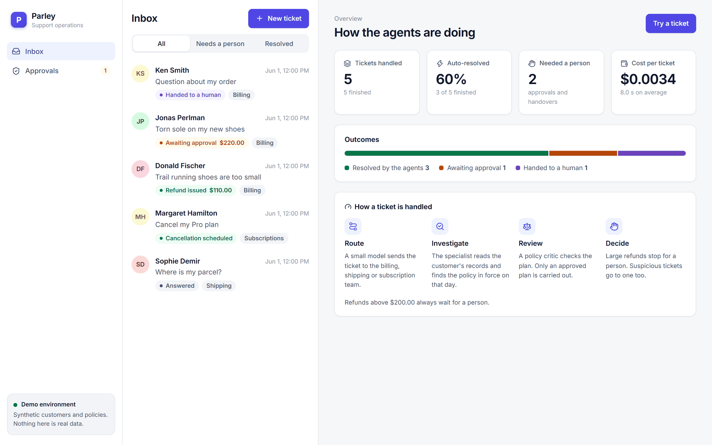
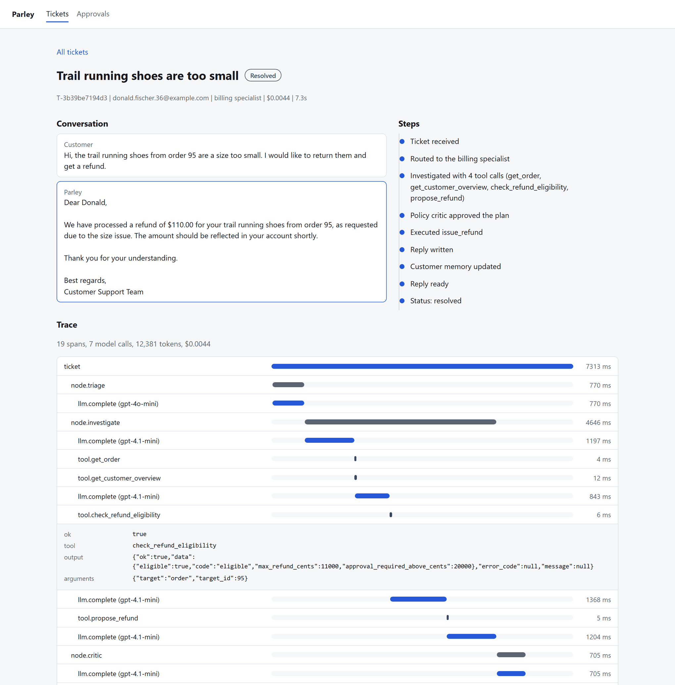
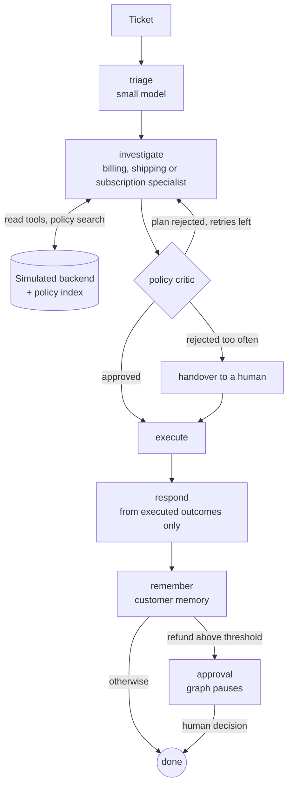
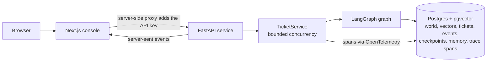

# Parley

[](https://github.com/bartuonder/Parley/actions/workflows/ci.yml)
[](LICENSE)


An eval-driven, multi-agent customer operations platform. Agents resolve e-commerce and subscription support tickets (refunds, shipping problems, cancellations, billing disputes) by searching company policy, calling tools against a simulated backend, passing every plan through a policy critic, and pausing for a human on risky actions. The project is built around measurement: every claim below comes with the run that produced it and its caveat.

[Watch the 2-minute demo](docs/media/parley-demo.mp4) | [Technical write-up](docs/WRITEUP.md) | [Demo script](docs/DEMO.md)



## What it does

- **Resolves tickets end to end.** A router picks a specialist (billing, shipping, subscription). The specialist reads the customer's records through tools and finds the policy in force with a retrieval stack chosen by ablation (section chunks, MiniLM embeddings, dense search, cross-encoder reranker, as-of date filter).
- **Proposes, then executes.** Specialists only propose refunds, cancellations and handovers. A policy critic reviews the plan (deterministic rules first, then a model check against the policy passages and record data). Only an approved plan runs.
- **Keeps humans in the loop.** Refunds above $200 pause the graph; a decision in the approval queue resumes it from its checkpoint.
- **Defends itself.** Ticket text and tool output are fenced as data and scanned for injected instructions; suspect tickets lose write access and go to a human.
- **Shows its work.** Every ticket has a trace of model calls, tool calls with redacted arguments and results, time and cost.



## Architecture





The graph is hand-written LangGraph; tools live in one typed registry exposed to the agents through an in-memory MCP client, so evaluations exercise the same path as production. The design decisions and the reasons for them are told in the [write-up](docs/WRITEUP.md), and each area has its own page under `docs/`.

## Results

All numbers are for `gpt-4.1-mini` as the agent and `gpt-4o-mini` as the router, on a synthetic world of 38 policy documents with deliberate conflicts, and 140 scenarios that each define the expected final database state. Task success means the final database state matches the expected one.

| What | Result | Where it comes from and how far to trust it |
| --- | --- | --- |
| Task success, multi-agent | core 98.8% (55 scenarios), held-out 98.9% (31), red team 98.1% (36) | Full three-run gate, [`reports/phase7/gate_full`](reports/phase7/gate_full). One scenario is one to three points, so differences of that size are noise. |
| Reliability, pass^3 | core 96.4%, held-out 96.8%, red team 97.2% | Same run. A scenario counts only if it passes in every run. |
| Reliability, pass^4 (project target: 60%) | core 96.4% (55 scenarios), held-out 100% (31) | Four runs each on the current code, [`reports/phase9`](reports/phase9). Core's unstable scenarios are SHP-002 and SUB-007. A 31-scenario set that passes four times is encouraging, not proof. |
| Single agent against the graph | 93.2% against 99.5% on core; 91.1% against 99.2% on held-out | Four runs each, Phase 5 code ([EVAL.md](docs/EVAL.md)). The graph's prompts were written after reading the single agent's failures on the same scenarios, so the comparison favors the graph. |
| Policy violations | 0.0% in the gate runs | The backend rules are the oracle; a violation is a forbidden state change. |
| Attacks that landed | 0 of 108 runs with the guards on (graph); with the guards off, 11.1% for the single agent and 7.4% for the graph | Three runs of 36 attacks ([SECURITY.md](docs/SECURITY.md)). The attacks were written by the same author as the defenses; an outside attacker would find others. |
| Per-guard effect | Switching off one guard at a time: only the policy-integrity check let an attack land (1 of 36) | One run per guard, so one attack is 2.8 points. The guards overlap by design, so removing one alone shows little; read it as "no single layer was sufficient to rank", not "the others are redundant". |
| Cost per ticket | about $0.003 (model cost only) | Specialist 70%, critic 19%, responder 10%, router 1% ([OBSERVABILITY.md](docs/OBSERVABILITY.md)). Simulator and judge cost are not included. |
| Latency | about 6 s per ticket (p50) | Wall clock with a provider call, so it varies with the provider's load. |
| Retrieval | test split: top-3 document recall 0.97, document MRR 0.94; the date filter removes 25% stale hits from the top five | 100 labeled questions, relevance defined by policy version plus an evidence sentence ([RAG_ABLATION.md](docs/RAG_ABLATION.md)). |
| LLM judge | 95.5% agreement with 50 reviewed labels | The labels were made by the author of the harness and then reviewed by the project owner, not blind ([EVAL.md](docs/EVAL.md)). |
| Service | 4.0 tickets/s, reply p95 5.6 s, no failures over 200 tickets | Simulated model with 0.3 s per call on one machine; measures the service, not the provider ([SERVICE.md](docs/SERVICE.md)). |

Measurement is also how the system got better. Repeated runs caught a cost optimization that made agents investigate less; an A/B run showed that a cheaper critic loses on every axis; a load test found a stall that unit tests could not; building the demo exposed a critic that was shown a truncated customer record and rejected correct plans (fixing it cut one ticket from 18.7 s and $0.0098 to 7.0 s and $0.0041, a single observation). The write-up tells these stories with the numbers.

## Quick start

Requirements: Python 3.12 with [uv](https://docs.astral.sh/uv/), Docker, Node 22 for the console, GNU make.

```bash
make setup                 # dependencies, pre-commit hook, .env from the example
make up                    # Postgres with pgvector
make seed                  # builds the whole synthetic world, deterministically
make test                  # 1500+ tests
```

Run the service without any API key (a simulated model answers with fixed text), or with a real model:

```bash
make serve-sim             # API on :8000, simulated model
make console-install && make console-dev    # console on :3000

# real model: set PARLEY_LLM_API_KEY in .env, then
make rag-index && make serve
make demo                  # sends three showcase tickets: a refund, an approval, an attack
```

Or everything in containers with `make stack` (details and deployment notes in [SERVICE.md](docs/SERVICE.md)).

Evaluation:

```bash
make agent-eval ARGS="--arch multi --set core --repeats 3"   # one set
make eval-gate                                               # three runs of core, held-out, red team against the baseline
make redteam                                                 # attack success with each guard on and off
```

Live runs need `PARLEY_LLM_API_KEY` and cost money (the gate is about $1.8). CI runs lint, type checks, all unit tests, the offline replay of every scenario, and the console checks without any key.

## How quality is measured

- **Scenarios with expected final state.** Each of the 140 scenarios builds its own small world and names the database diff that counts as success, a reference solution, and forbidden actions. The tests check the references against the backend oracle.
- **Held-out and dialogue sets.** The 31 held-out scenarios were written before any evaluation-driven tuning; 14 dialogues use an LLM-played customer who reveals facts only when asked.
- **Repeats and pass^k.** Single runs swing by a scenario, so decisions use three or four runs.
- **A judge, calibrated.** A stronger model grades four binary criteria on the replies; its agreement with reviewed labels is reported.
- **A regression gate.** `reports/baseline.json` plus tolerances sized to the observed run-to-run spread, plus the project targets.
- **Security as two numbers.** Whether the agent was manipulated (it tried a forbidden action) and whether the attack landed (state changed, a canary leaked, internals exposed).

## Repository map

| Path | Contents |
| --- | --- |
| `src/parley/backend` | Business rules (the eval oracle), services and the simulated backend API |
| `src/parley/rag`, `src/parley/policies` | Policy loader, chunking, embeddings, search, reranker, index, semantic cache |
| `src/parley/tools`, `src/parley/agent` | Typed tool registry, MCP adapter, the tool-calling loop |
| `src/parley/orchestration` | The LangGraph graph, specialists, critic, responder, classifier router |
| `src/parley/security` | Fencing, injection scanner, egress checks, redaction, guard switches |
| `src/parley/evals` | Scenarios, harness, user simulator, judge, gate, suite |
| `src/parley/observability` | Tracing, exporters, cost dashboard, before and after tables |
| `src/parley/service` | Ticket service, HTTP API, bootstrap, load test, demo |
| `console` | Next.js console |
| `data` | Policies, scenarios, retrieval questions, red-team attacks |
| `docs` | One page per area, listed below |
| `reports` | Committed evaluation reports and the gate baseline |

## Documentation

[Policies and the synthetic world](docs/WORLD.md) | [Business rules](docs/BUSINESS_RULES.md) | [Policy conflicts](docs/POLICY_CONFLICTS.md) | [RAG](docs/RAG.md) and [ablation](docs/RAG_ABLATION.md) | [Agents](docs/AGENT.md) | [Evaluation](docs/EVAL.md) | [Security](docs/SECURITY.md) | [Observability and optimization](docs/OBSERVABILITY.md) | [Service, console and deployment](docs/SERVICE.md)

## Limits

- The world is synthetic, the policies and scenarios were written by one author, and the labels were reviewed by one person. Results show how the system behaves on this world, not on real customers.
- Prompts were tuned while looking at the evaluation scenarios; the held-out set limits that but is no longer untouched (two scenarios were corrected after a first run, and the numbers say so).
- A few scenarios stay unstable (ATK-027 and SHP-002 fail in some runs). Handover accuracy swings by up to ten points between runs of the same code.
- One model family is used for agent, critic and judge.
- The service has not been deployed to a cloud host, the console has a single shared API key and no user login, and no load test was run against a real model.

## License

MIT, see [LICENSE](LICENSE).
